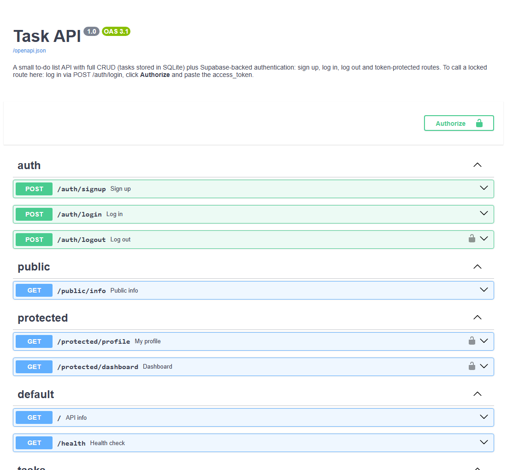

# Task API

A small to-do list API built with Python and FastAPI. It supports full CRUD
(create, read, update, delete) on tasks, stored in a **SQLite database**
(`tasks.db`), and **authentication with Supabase Auth**: sign up, log in, log
out, and routes that only answer to logged-in users.

Interactive docs (Swagger UI) are served at `/docs`.

> History: Assignment 1 kept tasks in a Python list. Assignment 2 swapped the
> storage layer for SQLite without changing the endpoints. Assignment 4 (this
> version) adds Supabase authentication. The task endpoints are unchanged and
> still open; auth is added as new routes (see [Authentication](#authentication)).

## Install and run

Requires Python 3.10+.

```bash
python -m venv .venv
# Windows:  .venv\Scripts\activate      macOS/Linux:  source .venv/bin/activate
pip install -r requirements.txt
cp .env.example .env        # then edit .env, see "Set up Supabase" below
uvicorn main:app --port 8000
```

Then open <http://localhost:8000/docs>. (`python main.py` also works and uses
`PORT` from `.env`.)

On first start the app creates `tasks.db`, creates the `tasks` table, and seeds
three example tasks. Nothing to set up by hand. Without Supabase values in `.env`
the server still starts and the Tasks API works; the auth routes answer `503`.

### Set up Supabase (about 5 minutes, free, no card)

1. Create a project at <https://supabase.com> (any name).
2. In **Project Settings → API**, copy the **Project URL** and the **anon / public key**.
   Never use the `service_role` key: it bypasses all security.
3. Put them in your `.env` (this file is git-ignored; never commit it):

   ```text
   SUPABASE_URL=https://your-project-ref.supabase.co
   SUPABASE_KEY=your_anon_key
   PORT=8000
   ```

4. In **Authentication → Sign In / Providers → Email**, turn **"Confirm email" off**
   so a new signup can log in immediately (practice project only; keep it on in production).
5. Start the server. The log should say `Server running and connected to Supabase (...)`.
   If it says `Supabase answered HTTP ...` or `Could not reach Supabase ...`, re-check the two values.

## Endpoints

| Method | Path | Description | Success | Errors |
|---|---|---|---|---|
| GET | `/` | API info (`name`, `version`, `endpoints`) | 200 | |
| GET | `/health` | Health check, returns `{"status": "ok"}` | 200 | |
| GET | `/tasks` | List all tasks | 200 | |
| GET | `/tasks/{id}` | Get one task | 200 | 404 unknown id |
| POST | `/tasks` | Create a task from `{"title": "..."}` | 201 | 400 missing/empty/invalid title |
| PUT | `/tasks/{id}` | Update `title` and/or `done` | 200 | 400 empty/invalid body, 404 unknown id |
| DELETE | `/tasks/{id}` | Delete a task (empty body) | 204 | 404 unknown id |

A task looks like `{"id": 1, "title": "Learn FastAPI", "done": false}`.
Every error response is JSON: `{"error": "message"}`.

## Authentication

Supabase stores the accounts, hashes the passwords and signs the tokens. This
server never stores or hashes a password: it forwards credentials to Supabase,
and on later requests asks Supabase whether the bearer token is real.

| Method | Path | Needs auth? | Description | Success | Errors |
|---|---|---|---|---|---|
| POST | `/auth/signup` | No | Create an account from `{"email", "password"}` | 201 + `{id, email, created_at}` | 400 missing field or rejected by Supabase |
| POST | `/auth/login` | No | Returns `access_token` and `refresh_token` | 200 | 400 missing field, 401 `Invalid login credentials` |
| POST | `/auth/logout` | **Yes** | Ends this session at Supabase | 204, empty body | 401 |
| GET | `/protected/profile` | **Yes** | The caller's `id`, `email`, `created_at` | 200 | 401 |
| GET | `/protected/dashboard` | **Yes** | A second locked route using the same guard | 200 | 401 |
| GET | `/public/info` | No | Open to everyone | 200 | |

Send the token as `Authorization: Bearer <access_token>`. A missing, malformed
(`Authorization: abc`, wrong scheme, empty token) or forged/expired token gets
`401` with a JSON error (`Access token required` or `Invalid or expired token`).
If Supabase itself is unreachable the guard answers `502` and refuses access
(it fails closed; it never lets a request through because verification failed).

### Try it with curl

Works without Supabase keys (real output):

```text
$ curl -i http://localhost:8000/public/info
HTTP/1.1 200 OK
content-type: application/json

{"message":"Welcome stranger! This info is public."}

$ curl -i http://localhost:8000/protected/profile
HTTP/1.1 401 Unauthorized
www-authenticate: Bearer
content-type: application/json

{"error":"Access token required"}
```

With your Supabase project configured, the full flow is:

```bash
curl -i -X POST http://localhost:8000/auth/signup -H "Content-Type: application/json" -d '{"email":"test@example.com","password":"password123"}'      # 201
curl -i -X POST http://localhost:8000/auth/login  -H "Content-Type: application/json" -d '{"email":"test@example.com","password":"password123"}'      # 200 + access_token
curl -i http://localhost:8000/protected/profile -H "Authorization: Bearer <access_token>"                                                          # 200 + your user
curl -i http://localhost:8000/protected/profile -H "Authorization: Bearer <access_token with one character changed>"                               # 401
curl -i -X POST http://localhost:8000/auth/logout -H "Authorization: Bearer <access_token>"                                                        # 204
```

The login response has this shape (values are placeholders):

```json
{"access_token": "<jwt>", "refresh_token": "<token>", "token_type": "bearer", "expires_in": 3600}
```

### Swagger UI with the Authorize padlock



Log in with `POST /auth/login`, click **Authorize**, paste the `access_token`
(only the token, without the word `Bearer`), then use **Try it out** on
`GET /protected/profile`.

### How the guard works

`require_user` in [auth.py](auth.py) is a FastAPI dependency: it extracts the
bearer token, calls Supabase `get_user(token)` (a real network call, so the
answer is trustworthy), and hands the route the verified user. Any route
becomes logged-in-only by adding `Depends(require_user)`; `/protected/profile`,
`/protected/dashboard` and `/auth/logout` all share it, and a test fails if a
`/protected/*` route is ever left unguarded.

Design notes:

- **A new Supabase client per request.** A shared client remembers the last
  user who logged in; one per request means sessions can never leak between users.
- **Logout uses `auth.admin.sign_out(jwt)`.** `auth.sign_out()` only ends a
  session stored inside the client, and a server holds none, so it would do
  nothing for the caller. The admin variant revokes the session behind a given
  token (it calls the same `/logout` endpoint with the user's own token, so the
  anon key is enough).
- **Logout is not instant for the access token.** A JWT stays valid until it
  expires (Supabase default: one hour). Logout revokes the session and refresh
  token, so no new access tokens can be minted from it.
- **Tokens and passwords are never logged.**

### Tests

```bash
pip install -r requirements-dev.txt
pytest
```

The 22 tests in `tests/test_auth.py` run against a **fake Supabase client**
(`tests/conftest.py`), so they need no keys and no network. They cover the status
codes, the `Bearer` parsing edge cases, forged/tampered tokens, Supabase being
down, and that every protected route is guarded. They check this server's logic
against a model of Supabase; the real login flow is the curl/Swagger walkthrough above.
`python tests/check_api.py` still checks the Tasks API against a running server.

## Why SQLite?

- **One file, zero setup.** The whole database is `tasks.db`. There is no
  database server to install, configure or keep running.
- **It survives restarts.** Data is on disk instead of in the program's memory.
- **It is enough for this job.** A single-user to-do API does not need a
  networked database; if it ever outgrows one file, only the storage layer
  (`db.py`) would need to change.

## Where the database lives

- **File:** `tasks.db`, next to `main.py` (override the path with the `TASKS_DB`
  environment variable).
- **Created automatically** on first start. It is listed in `.gitignore`, so
  every clone starts with a fresh database and the three seeded tasks.
- **Schema:**

  ```sql
  CREATE TABLE IF NOT EXISTS tasks (
      id    INTEGER PRIMARY KEY AUTOINCREMENT,
      title TEXT NOT NULL,
      done  INTEGER NOT NULL DEFAULT 0   -- 0 = false, 1 = true
  );
  ```

- **Code layout:** all SQL lives in `db.py`. `main.py` holds the routes and
  validation and calls `db.py`. Every query uses `?` placeholders, so user input
  is never glued into SQL text.
- **Seeding is all-or-nothing.** The three example rows are inserted in one
  transaction, only when the table is empty. A transaction matters because a
  half-finished multi-step change would otherwise leave the database in a
  broken in-between state.

## Database in DB Browser for SQLite


## Example SQL from Stage 4

```sql
SELECT * FROM tasks WHERE done = 1;
```

It returned only the completed task, `(2, 'Build a CRUD API', 1)`. More queries
and what they returned are in [docs/stage4-sql.md](docs/stage4-sql.md). Changes
made to the database directly showed up in `GET /tasks` immediately, with no
server restart, because the API and the SQL client read the same file.

## Example: `curl -i`

```text
$ curl -i -X POST http://localhost:8000/tasks -H "Content-Type: application/json" -d '{"title":"Buy milk"}'
HTTP/1.1 201 Created
date: Tue, 17 Nov 2026 13:43:59 GMT
server: uvicorn
content-length: 40
content-type: application/json

{"id":4,"title":"Buy milk","done":false}

$ curl -i http://localhost:8000/tasks/99
HTTP/1.1 404 Not Found
date: Tue, 17 Nov 2026 13:44:00 GMT
server: uvicorn
content-length: 29
content-type: application/json

{"error":"Task 99 not found"}
```

## Swagger UI


## Persistence check

After creating tasks, restarting the server and calling `GET /tasks` again, the
tasks were still there:

```text
{'id': 4, 'title': 'Buy milk', 'done': False}
{'id': 5, 'title': 'Call mom', 'done': False}   <- created before the restart
```

In Assignment 1 the same experiment lost every new task, because the list lived
in the running process's memory.

## Proof that the API did not change

`tests/check_api.py` replays the Assignment 1 checks over plain HTTP: 19 checks
covering every endpoint and every 200/201/204/400/404 case.

```bash
python tests/check_api.py            # server must be running on :8000
```

I ran the same script against both versions. It passed 19/19 against the
in-memory Assignment 1 code and 19/19 against this SQLite version. The test only
sees requests and responses, so identical results show that the client cannot
tell where the data is stored. Storage is an implementation detail behind the API.

## What happens when the server restarts?

The data stays. The three seeded tasks are not duplicated, because the seed
runs only when the table is empty. (Corner case: if you delete every task, the
table is empty again, so the next start seeds the three examples once more.)
