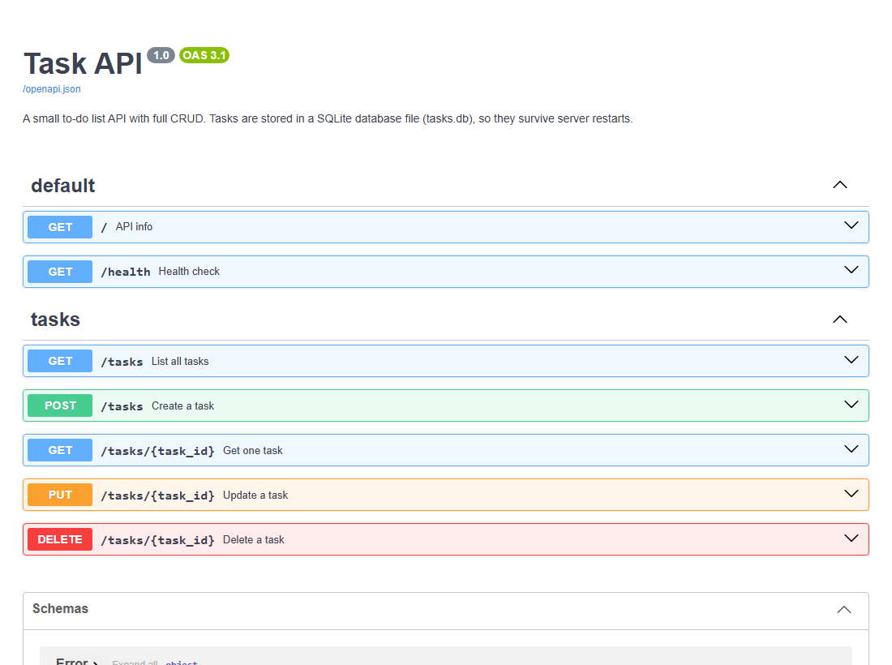

# Task API

A small to-do list API built with Python and FastAPI. It supports full CRUD
(create, read, update, delete) on tasks. Data is kept **in memory only**: there
is no database, and everything resets when the server restarts.

Interactive docs (Swagger UI) are served at `/docs`.

## Install and run

Requires Python 3.10+.

```bash
python -m venv .venv
# Windows:  .venv\Scripts\activate      macOS/Linux:  source .venv/bin/activate
pip install -r requirements.txt
uvicorn main:app --port 8000
```

Then open <http://localhost:8000/docs>.

## Endpoints

| Method | Path | Description | Success | Errors |
|---|---|---|---|---|
| GET | `/` | API info (`name`, `version`, `endpoints`) | 200 | |
| GET | `/health` | Health check, returns `{"status": "ok"}` | 200 | |
| GET | `/tasks` | List all tasks | 200 | |
| GET | `/tasks/{id}` | Get one task | 200 | 404 unknown id |
| POST | `/tasks` | Create a task from `{"title": "..."}` | 201 | 400 missing/empty/invalid title |
| PUT | `/tasks/{id}` | Update `title` and/or `done` | 200 | 400 empty/invalid body, 404 unknown id |
| DELETE | `/tasks/{id}` | Delete a task (empty body) | 204 | 404 unknown id |

A task looks like `{"id": 1, "title": "Learn FastAPI", "done": false}`.
Every error response is JSON: `{"error": "message"}`.

## Example: `curl -i`

```text
$ curl -i -X POST http://localhost:8000/tasks -H "Content-Type: application/json" -d '{"title":"Buy milk"}'
HTTP/1.1 201 Created
date: Tue, 17 Nov 2026 13:43:59 GMT
server: uvicorn
content-length: 40
content-type: application/json

{"id":4,"title":"Buy milk","done":false}

$ curl -i http://localhost:8000/tasks/99
HTTP/1.1 404 Not Found
date: Tue, 17 Nov 2026 13:44:00 GMT
server: uvicorn
content-length: 29
content-type: application/json

{"error":"Task 99 not found"}
```

## Swagger UI



## What happens when the server restarts?

I created a "Buy milk" task, restarted the server, and listed tasks again. The
task was gone and only the 3 seed tasks remained. The tasks live in a Python
list inside the running process, so when the process stops the memory is freed
and the data disappears; a database is what keeps data across restarts.
