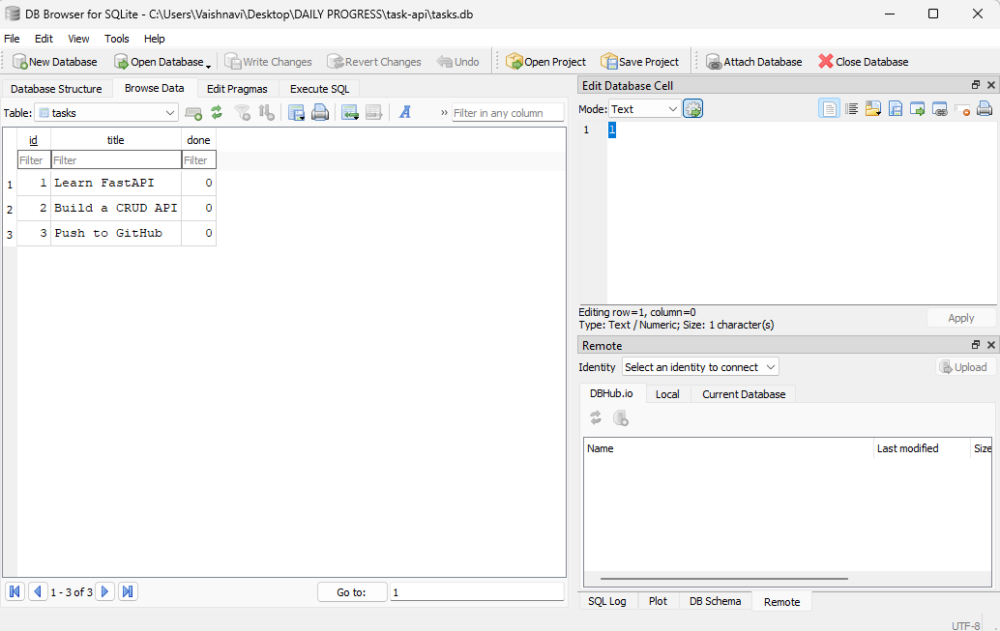

# Task API

A small to-do list API built with Python and FastAPI. It supports full CRUD
(create, read, update, delete) on tasks. Tasks are stored in a **SQLite
database** (`tasks.db`), so they survive server restarts.

Interactive docs (Swagger UI) are served at `/docs`.

> History: Assignment 1 kept tasks in a Python list (in memory). Assignment 2
> (this version) replaced only the storage layer with SQLite. The endpoints did
> not change.

## Install and run

Requires Python 3.10+. SQLite ships with Python, so there is nothing extra to install.

```bash
python -m venv .venv
# Windows:  .venv\Scripts\activate      macOS/Linux:  source .venv/bin/activate
pip install -r requirements.txt
uvicorn main:app --port 8000
```

Then open <http://localhost:8000/docs>.

On first start the app creates `tasks.db`, creates the `tasks` table, and seeds
three example tasks. Nothing to set up by hand.

## Endpoints

| Method | Path | Description | Success | Errors |
|---|---|---|---|---|
| GET | `/` | API info (`name`, `version`, `endpoints`) | 200 | |
| GET | `/health` | Health check, returns `{"status": "ok"}` | 200 | |
| GET | `/tasks` | List all tasks | 200 | |
| GET | `/tasks/{id}` | Get one task | 200 | 404 unknown id |
| POST | `/tasks` | Create a task from `{"title": "..."}` | 201 | 400 missing/empty/invalid title |
| PUT | `/tasks/{id}` | Update `title` and/or `done` | 200 | 400 empty/invalid body, 404 unknown id |
| DELETE | `/tasks/{id}` | Delete a task (empty body) | 204 | 404 unknown id |

A task looks like `{"id": 1, "title": "Learn FastAPI", "done": false}`.
Every error response is JSON: `{"error": "message"}`.

## Why SQLite?

- **One file, zero setup.** The whole database is `tasks.db`. There is no
  database server to install, configure or keep running.
- **It survives restarts.** Data is on disk instead of in the program's memory.
- **It is enough for this job.** A single-user to-do API does not need a
  networked database; if it ever outgrows one file, only the storage layer
  (`db.py`) would need to change.

## Where the database lives

- **File:** `tasks.db`, next to `main.py` (override the path with the `TASKS_DB`
  environment variable).
- **Created automatically** on first start. It is listed in `.gitignore`, so
  every clone starts with a fresh database and the three seeded tasks.
- **Schema:**

  ```sql
  CREATE TABLE IF NOT EXISTS tasks (
      id    INTEGER PRIMARY KEY AUTOINCREMENT,
      title TEXT NOT NULL,
      done  INTEGER NOT NULL DEFAULT 0   -- 0 = false, 1 = true
  );
  ```

- **Code layout:** all SQL lives in `db.py`. `main.py` holds the routes and
  validation and calls `db.py`. Every query uses `?` placeholders, so user input
  is never glued into SQL text.
- **Seeding is all-or-nothing.** The three example rows are inserted in one
  transaction, only when the table is empty. A transaction matters because a
  half-finished multi-step change would otherwise leave the database in a
  broken in-between state.

## Database in DB Browser for SQLite



## Example SQL from Stage 4

```sql
SELECT * FROM tasks WHERE done = 1;
```

It returned only the completed task, `(2, 'Build a CRUD API', 1)`. More queries
and what they returned are in [docs/stage4-sql.md](docs/stage4-sql.md). Changes
made to the database directly showed up in `GET /tasks` immediately, with no
server restart, because the API and the SQL client read the same file.

## Example: `curl -i`

```text
$ curl -i -X POST http://localhost:8000/tasks -H "Content-Type: application/json" -d '{"title":"Buy milk"}'
HTTP/1.1 201 Created
date: Tue, 17 Nov 2026 13:43:59 GMT
server: uvicorn
content-length: 40
content-type: application/json

{"id":4,"title":"Buy milk","done":false}

$ curl -i http://localhost:8000/tasks/99
HTTP/1.1 404 Not Found
date: Tue, 17 Nov 2026 13:44:00 GMT
server: uvicorn
content-length: 29
content-type: application/json

{"error":"Task 99 not found"}
```

## Swagger UI


## Persistence check

After creating tasks, restarting the server and calling `GET /tasks` again, the
tasks were still there:

```text
{'id': 4, 'title': 'Buy milk', 'done': False}
{'id': 5, 'title': 'Call mom', 'done': False}   <- created before the restart
```

In Assignment 1 the same experiment lost every new task, because the list lived
in the running process's memory.

## Proof that the API did not change

`tests/check_api.py` replays the Assignment 1 checks over plain HTTP: 19 checks
covering every endpoint and every 200/201/204/400/404 case.

```bash
python tests/check_api.py            # server must be running on :8000
```

I ran the same script against both versions. It passed 19/19 against the
in-memory Assignment 1 code and 19/19 against this SQLite version. The test only
sees requests and responses, so identical results show that the client cannot
tell where the data is stored. Storage is an implementation detail behind the API.

## What happens when the server restarts?

The data stays. The three seeded tasks are not duplicated, because the seed
runs only when the table is empty. (Corner case: if you delete every task, the
table is empty again, so the next start seeds the three examples once more.)
